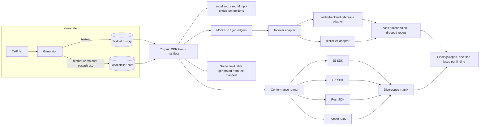

# Technical architecture

Stellar XDR Shape Corpus and Indexer-Hardening Kit, submitted to the Stellar Community Fund for the RFP "XDR/CAP-Coverage Audit Tool and Indexer-Hardening Guide".

This document describes how the kit is built on Stellar ledger data, what already runs in this repository, and what each tranche adds. Everything referenced here is in this repository and runs in its GitHub Actions workflows.

Contents: 1. Summary, 2. Design and Stellar integration, 3. What already runs, 4. Security and disclosure, 5. Integration and maintenance, 6. Milestones and budget, 7. CAP list.

## 1. Summary

Stellar XDR Shape Corpus is a working prototype of the kit this RFP describes: a corpus of real, core-emitted XDR for rare ledger shapes (nine entries today, one per shape the RFP lists; every CAP family that changed a ledger shape by tranche 2), each tagged with its CAP and the values a correct decoder must produce; a replay harness that runs the corpus through any indexer and reports `pass`, `mishandled` or `dropped`; a conformance runner that runs the same corpus through the JavaScript, Go, Rust and Python SDKs; and an indexer-hardening guide.

The work has already started, in public. The reviewability package the RFP requires (draft manifest schema, two or three sample entries, one reproduced sighting) is in the repository:

| RFP asks for | Already in the repository |
| --- | --- |
| Draft manifest schema | JSON Schema 2020-12, validated in CI |
| Two or three sample entries | Nine entries captured on testnet at protocol 30, one for every shape the RFP lists (out-of-range offer and muxed IDs, which the network cannot emit, are covered as SDK API checks instead), none synthetic, each with envelope, result, `TransactionMeta` v4 and the full `LedgerCloseMeta`; every file round-trips byte-identical through rs-stellar-xdr 30.0.0 |
| `--check-lcm` goldens | In CI at a pinned stellar-core commit: all 15,306 golden ledgers decode byte-identical. Of the 32 shapes in the nine entries, 14 have a golden to compare with (13 agree, 1 appears elsewhere); the other 18 never appear in core's own test output, and the report lists them |
| One reproduced sighting | In CI (`wallet-backend replay` workflow, which rebuilds wallet-backend at nine commits): three RFP sightings reproduced on pre-fix commits and passing on the fixed ones: wallet-backend#731, #729 and the signed-payload half of #716 (the muxed half is not reproduced yet, see section 6). Pre-fix commits pin go-stellar-sdk v0.7.3, which cannot read a protocol 30 ledger header, so only that dependency is raised to v0.8.0 on both sides of each fix. Also the muxed-destination gap closed by wallet-backend#792, with no change at all |
| Upstream issues | Five issues filed: four from cross-SDK probes in the Python and Go SDKs and the Rust XDR library, including the Python siblings of js-stellar-sdk#1789 and #1785, with a fix pull request for each of those four; and stellar/go-stellar-xdr-json#27 from the stellar-etl run |
| Conformance runner | Running in CI across JS, Go, Rust and Python: all 36 corpus files round-trip byte-identical in the current releases (JS 17.2.x predates protocol 30 and cannot decode the ledgers), and js-stellar-sdk#1766, #1785 and #1789 reproduce on their pre-fix tags and pass on 17.4.0. The sighting checks use small vectors and SDK API calls, marked `synthetic` in `conformance/sightings.json`; tranche 2 moves them onto corpus entries |
| Mock `getLedgers` input | The wallet-backend adapter reads every ledger through a mock RPC `getLedgers` endpoint, with the adapter contract documented in `harness/ADAPTER.md` |
| Reproducible generation (tranche 1 item, started) | In CI (`corpus generator` workflow): `cap40` and `cap27` are regenerated on a local stellar-core 30.0.0 under the testnet and the mainnet passphrase, with no network contacted, and checked against the committed entries: 108 checks match, 6 are skipped because they depend on generated keys, ledger or time, 0 differ |
| Second SDF pipeline (tranche 2 item, started) | In CI (`stellar-etl replay` workflow): the corpus runs through stellar-etl's own export code at a pinned commit. 6 entries pass; the other 3 reproduce stellar-etl#460 (open) and the legacy `parameters_decoded` column, which #330 complemented with `parameters_json_decoded` but which is still exported |

## 2. Design and Stellar integration

**How the kit uses Stellar.** Everything in the kit is Stellar ledger data and the software that reads it. Entries are transactions submitted to Stellar testnet, and to a local stellar-core under the testnet and mainnet passphrases, captured as the XDR stellar-core emitted: `TransactionEnvelope`, `TransactionResult`, `TransactionMeta` v4 and `LedgerCloseMeta` v2, retrieved through stellar-rpc `getTransaction` and `getLedgers`. Every file is checked with rs-stellar-xdr and against stellar-core's own `--check-lcm` goldens. The harness replays those ledgers into Stellar indexers (wallet-backend and stellar-etl today) through the `getLedgers` interface they consume in production, and the conformance runner decodes them with the JavaScript, Go, Rust and Python Stellar SDKs. A small Soroban probe contract, open source in the repository (Apache-2.0, `tools/contracts/probe/`), is deployed on testnet only, so that the map-key and nested-authorization shapes appear in real meta; it holds no funds and is never deployed to mainnet.

**Corpus and generator.** Entries are XDR that stellar-core actually emitted, captured with ephemeral keys funded by friendbot (no keys are stored or printed). For reproducible generation on both passphrases without mainnet keys or funds, a generator drives a local stellar-core in a container configured with the chosen passphrase; it already regenerates two entries on both passphrases in CI, and tranche 1 extends it to every entry it can produce. Hand-crafted entries, used only where core cannot be made to emit a shape, carry `synthetic: true`. Entries are checked against rs-stellar-xdr, as CI already does, and against the stellar-core `--check-lcm` goldens (stellar-core#5435), already in CI: since a testnet ledger can never be byte-equal to a golden made on core's test network, the check decodes every golden at a pinned core commit and reports each entry's shapes as `agrees`, `elsewhere` or `no-golden`; the `no-golden` list shows which shapes core's own tests never emit. The coverage manifest lists every CAP that introduced or changed a ledger shape, with its entries and status, so gaps are visible and the corpus grows with each protocol.

**Replay harness.** First input: a mock RPC `getLedgers` endpoint. Every `LedgerCloseMeta` in the corpus is already captured through `getLedgers`, and most pipelines can point at it by URL. The reference adapter already reads every ledger through that mock endpoint with go-stellar-sdk's `RPCLedgerBackend`, the backend wallet-backend builds when configured for RPC; tranche 2 hardens it and tranche 3 adds the second input. The adapter interface is a small, documented contract: the harness serves ledgers, the adapter reports what the indexer stored per entry, and the harness compares it with what the entry should produce. Today that comparison is written per sighting for the four sighting entries, and is an address round trip for the other five; tranche 2 makes it generic against the manifest's expected values, which are extended to the meta and `LedgerCloseMeta` fields an indexer stores (today each entry has one to five shape values, mostly from the envelope, plus the seven `LedgerCloseMeta` values). The Galexie data-lake layout is the natural second input. Memory stays bounded: ledgers stream one at a time.

**Conformance runner.** One CI job per SDK (JavaScript, Go, Rust, plus Python) decodes every entry, compares the expected values, re-encodes and compares bytes. Divergences from the network and between SDKs go into a matrix. Acceptance: js-stellar-sdk#1766, #1785 and #1789 reproduce on their pre-fix tags. When a defect shows up in one SDK, the sibling issue goes to every other affected SDK, as already done in Python for #1789 and #1785.

**Guide.** Fixed outline from the RFP (validated vs. unvalidated fields, depth and size caps, participants from meta, muxed and signed-payload handling with SEP-0023 forms, checklist). Every statement about what core validates cites the stellar-core source line. The field-by-field table is generated from the same data as the manifest, so the two cannot disagree. Publication goes through review by a core or platform engineer.

**Linter.** Outside this budget, as the RFP allows: the guide's checklist carries the three checks for every language. XDRL002 stays public as a working reference for Go indexers; the other two rules are not part of this proposal.

## 3. What already runs

**Corpus.** Each entry lives in `corpus/entries/<id>/` and is indexed by `corpus/manifest.json`: CAPs, protocol version, network and passphrase, ledger and transaction hash, capture method, shapes covered, sightings that motivated it, sha256 of every file, and expected values as JSON Pointers into the SEP-51 XDR-JSON form. The manifest generator reads every expected value back from the bytes and refuses to write if one does not match, and CI fails if the committed manifest drifts from the bytes. Besides the shape values, every entry carries seven values from its `LedgerCloseMeta` (header, CAP-0088 close time, place in the CAP-0042 and CAP-0063 transaction set, apply position, fee), each checked against data read separately from those bytes. The manifest also records how the meta inside the `LedgerCloseMeta` compares with the meta `getTransaction` returned: identical in five entries, different only in measured host time in three, and in one the same changes arrive in a different order, which an indexer that compares meta by position has to tolerate.

| Entry | CAP | What it exercises |
| --- | --- | --- |
| `cap40-signed-payload-signer-max-payload` | CAP-0040 | Signed-payload signer with a 64-byte payload, the maximum |
| `cap27-muxed-source-and-destination-id-extremes` | CAP-0027 | Muxed source with id u64 max and muxed destination with id 0 |
| `cap73-sac-created-trustline` | CAP-0073 | Trustline created by SAC `trust()`, with no ChangeTrust and no contract event |
| `cap67-sac-transfer-to-muxed-address-max-id` | CAP-0067 | SAC `transfer()` to a muxed `ScAddress`; the id travels in the event's `to_muxed_id` |
| `cap38-pool-share-issuers-ordered-by-key-bytes` | CAP-0038 | Pool-share trustline and deposit for two assets whose issuers sort one way by `G…` text and the other way by key bytes |
| `cap46-scmap-keys-collide-after-native-conversion` | CAP-0046 | `ScMap` with keys u32 `1`, string `"1"` and symbol `"1"` in a contract's argument, return value and event |
| `cap46-nested-authorization-contract-calls-sac` | CAP-0046 | Authorization entry with a native SAC `transfer` as sub-invocation |
| `cap21-vectors-at-max-length` | CAP-0021, CAP-0040 | 100 operations, a 28-byte memo and two extra signers, all at their bound (the operation and memo bounds predate CAPs; CAP-0021 brings the extra signers) |
| `cap06-manage-buy-offer-update-by-id` | CAP-0006 | Offer updated by the ID core assigned; out-of-range IDs stay covered as SDK API checks |

**Replay harness with a wallet-backend reference adapter.** The adapter decodes the captured `LedgerCloseMeta`, runs wallet-backend's own indexer over the transaction, and calls the same `Value()` and `Scan()` the COPY path uses, so it shows exactly which bytes would be stored and what reads back, without a database. Protocol 30 ledger headers need go-stellar-sdk v0.8.0, the version wallet-backend `main` pins today, so the August and September commits are measured with only that dependency raised to v0.8.0 and their own code unchanged; the same bump on both sides of each fix isolates wallet-backend's change. #792 needs no bump at all.

| Sighting | Pre-fix commit | Fixed commit |
| --- | --- | --- |
| wallet-backend#731 | `dropped` at `764a4f5b` | `pass` at `c152783c` |
| wallet-backend#729 | `dropped` at `2a0a84ea` (observed in CI with wallet-backend's own `migrate` and `ingest` against TimescaleDB: the COPY fails with SQLSTATE 57014, the ledger rolls back, ingest retries 5 times and exits, and a restart fails on the same ledger) | `pass` at `2c873353` |
| wallet-backend#716 (signed payload) | `mishandled` at `79ea2acd` (33 bytes stored, key unreadable) | `pass` at `2c873353` and `71625b21` |
| wallet-backend#792 (muxed destination) | `mishandled` at `a9bac8d2` (`to_muxed_id` lost) | `pass` at `09303667` |

**stellar-etl adapter.** The second adapter runs each corpus ledger, served over the same mock `getLedgers`, through stellar-etl's own per-ledger export functions and its ledger-entry transforms, and reads back the JSON lines and the Parquet structs they produce. Large integers come through exact, including u64-max muxed IDs and i64-max trustline limits. Three entries do not pass, and all three are already known upstream: the SAC-created trustline produces no effect row and the SAC transfer to a muxed address loses the muxed address in the `effects` table (both stellar-etl#460, open), and the colliding map keys print as `1` three times in the legacy `parameters_decoded` column (the exact `parameters_json_decoded` column added by #330 keeps them apart). The run also reproduces with real ledgers the lossy `token_transfers.amount` that stellar-etl#454 describes.

**Cross-SDK probes and upstream issues.** Byte-level probes and the defect classes from the JavaScript SDK audit were run through the Go, Rust and Python SDKs. Each issue below was re-run on the latest release the day it was filed, checked for duplicates, and cites the source lines involved:

- StellarCN/py-stellar-base#1250: `scval.to_native` drops map entries whose keys collide, the Python sibling of js-stellar-sdk#1789.
- StellarCN/py-stellar-base#1251: out-of-range 64-bit integers serialize modulo 2^64, so an offer ID or muxed ID encodes a different ID (sibling of js-stellar-sdk#1785).
- stellar/go-stellar-sdk#6039: `SafeUnmarshalBase64` accepts 1 or 2 trailing bytes that stellar-core rejects.
- stellar/rs-stellar-xdr#621: the `StringM` JSON schema rejects the JSON the crate itself emits for non-ASCII strings.
- stellar/go-stellar-xdr-json#27: Go 1.27.4 rejects the library's prebuilt archives (`.llvmbc` sections), so stellar-etl stops building on the current Go release; found by the stellar-etl adapter and reproduced on Linux and Windows.

Maintainer replies so far. On #1251 the py-stellar-base maintainer said he will review #1252 and #1253 and suggested running the corpus against py-stellar-xdr, the XDR library the next major version of the SDK will use. It now runs in CI as another conformance column: all 36 files byte-identical, its JSON equal to rs-stellar-xdr's, 95 of 95 expected values. On rs-stellar-xdr#621 the maintainer confirmed the issue and proposed a fix, which stellar/rs-stellar-xdr#624 implements. go-stellar-sdk#6039 and #6041 have no reply yet.

**Conformance runner.** CI decodes and re-encodes all 36 corpus files with js-stellar-sdk 17.4.0, go-stellar-sdk v0.9.0, rs-stellar-xdr 30.0.0 and Python stellar-sdk 17.0.1, all byte-identical, and runs six sighting checks against each SDK. Today the checks are small vectors and API calls, and the runners compare bytes, not yet the manifest's expected values; both are tranche 2 work. js-stellar-sdk#1766 reproduces on 17.2.0, #1785 and #1789 on 17.2.1, and all three pass on 17.4.0. The Python column shows the two open siblings, py-stellar-base#1250 and #1251, and CI expects them until they are fixed. The full matrix, with the reason for every `n/a`, is in `conformance/MATRIX.md`.

**Linter.** `xdrlint` (go/analysis) ships rule XDRL002, recursive XDR walks without a depth bound. It flags the seeded violations in its tests (run in CI), runs clean on wallet-backend `main` (40 packages, run by hand and recorded in `linter/README.md`), and reports a positive control placed inside wallet-backend using its real XDR types.

## 4. Security and disclosure practice

Findings that could affect consensus, the Soroban host or funds are reported privately through SDF's bug bounty program on HackerOne and stay private until SDF consents. Everything else is filed as a public issue only after it reproduces on the latest release, with a minimal script, actual output, expected behavior with a cited source, and a duplicate search. Corpus capture uses ephemeral keys only; no secret ever enters the repository.

## 5. Integration and maintenance

The corpus is plain files plus a JSON manifest, so any pipeline or SDK can consume it without depending on this project's code. The harness plugs into existing pipelines through RPC `getLedgers`, which they already consume. Kevin maintains all deliverables for 12 months after the final milestone, without charge, which covers the first protocol upgrade after delivery: new CAP shapes added to the corpus, SDK pins updated in CI, the guide revised. The upgrade tooling in 3.6 makes that work mechanical. For handover, everything a maintainer needs is in the repository (scripts, CI, the generator, the manifest generator) and nothing depends on Kevin's accounts; if SDF wants the kit under one of its GitHub organizations, Kevin transfers the repository. Pull requests and new entries from other teams are welcome, and every contribution passes the same CI.

**Infrastructure:** GitHub and GitHub Actions only. No hosted service, no database, no telemetry and no user tracking.

**Decentralization:** there is no service to decentralize. The kit is plain files, a JSON manifest and scripts that anyone can clone, run offline and fork; nothing depends on a server or account run by this project.

**Open source:** Apache-2.0, developed in public. Status updates are posted in the pinned issue kasbsquall/xdr-shape-corpus#1 at every milestone and at least weekly while work is active. The issue body and six update comments were posted while the prototype was built, between 12 and 13 November 2026.

## 6. Milestones and budget

The RFP's milestone 2 checks already run in CI, with the caveats in section 3 (bumped SDK on pre-fix commits, #716 muxed half pending, runner checks on vectors), and stay in every tranche as regression gates. What the money buys: real core-emitted entries for about 20 more CAP families, older formats from mainnet history, a union-arm coverage report, generation on both passphrases for every entry, the stellar-etl run on the full corpus, the generic harness comparison, the full SDK matrix, a mainnet replay, the threat model and monitors, the guide and the upgrade tooling.

How the tranches map to the RFP's milestones and section 1 checks. The payment split (10% on award, then 20/30/40) is the one recent Build awards use; the content follows the RFP's milestone order, and each check is verified in the tranche named.

| RFP milestone | RFP section 1 check | Tranche |
| --- | --- | --- |
| 1. Guide, corpus and generator with per-CAP manifest | Entries round-trip through rs-stellar-xdr and agree with `--check-lcm` goldens; guide field table matches the manifest | 1.1 to 1.5, 2.1 and 3.2 |
| 2. Harness, adapter interface, reference adapter, conformance runner, findings reports | Reference adapter reproduces wallet-backend#729, #731, #716; runner reproduces js-stellar-sdk#1766, #1785, #1789; every failure maps to a filed issue | 2.2 to 2.6 (the checks already run in CI and stay as gates) |
| 3. Linter | Out of this budget, as the RFP allows; the guide's checklist stands in | none |
| 4. Production release, protocol 30 coverage, CI, maintenance plan | Release and maintenance plan published | 3.1 and 3.3 to 3.7 |

SCF's tranche 2 threat model and monitoring plan is deliverable 2.7, and its monitors run on the release as 3.5. The tranche names follow SCF's MVP, Testnet and Mainnet structure: tranche 2 is the Soroban-era coverage built and tested on testnet, and tranche 3 brings real mainnet ledgers and mainnet history into the corpus and the harness. If a tranche slips, the cut order is: the SDK CI pull requests first, then the Galexie replay (the mock `getLedgers` input already works); corpus coverage, the RFP checks, the findings reports and the threat model are not cut.

Out of scope: Horizon and stellar-rpc's own ingestion, which their owners can plug in through the frozen adapter interface (this budget covers wallet-backend and stellar-etl, the two pipelines the RFP names), and history-archive bucket formats (CAP-0020), which readers of transactions and meta do not see.

Requested budget: USD 57,500, at the RFP's estimate without the linter. 10% (USD 5,750) is the first payment on award, and the rest is split across three tranches of 20%, 30% and 40%. Kevin works on this project full time, 30 to 40 hours a week, for its 16 weeks.

### Tranche 1 (Deliverable Roadmap) - MVP: corpus coverage for protocols 10 to 19, coverage report, generator, guide draft

1.1 **CAP list fixed** (USD 1,000). The draft list in the CAP list in section 7 (29 CAP families; 7 with a dedicated entry today, 3 more present in every ledger) is cross-checked against the released XDR in week 1 and fixed for the project. Each shape is tagged with the CAP that introduced it. *Completion:* the fixed list is published in the repository, with the reason for every CAP left out.

1.2 **Entries for the 14 CAP families from protocols 10 to 19** (USD 5,000). CAP-0001 to CAP-0040; 5 are covered today. Each entry is real stellar-core output (envelope, result, meta and `LedgerCloseMeta`) with its expected values and its `--check-lcm` result. These entries carry today's protocol 30 formats; the older formats of the same shapes come from mainnet history in 3.2. *Completion:* every protocol 10 to 19 family on the fixed list has at least one entry in the manifest, and every entry round-trips byte-identical through rs-stellar-xdr in CI. The only exception is a shape stellar-core cannot emit, covered as an SDK API check that cites the core source line.

1.3 **Union-arm coverage report** (USD 1,500). Generated from the stellar-xdr `.x` definitions. For every union arm and enum value that can appear in a transaction, result, meta, ledger entry or ledger header, it lists the corpus entries that contain it, or marks it as excluded with a reason, or as a gap. *Completion:* the report is regenerated in CI from the `.x` files and the manifest on every change, and every gap names the tranche that closes it.

1.4 **Reproducible generator** (USD 2,000). Drives a local stellar-core in a container on the testnet and mainnet passphrases, so any entry can be regenerated from a clean checkout with no mainnet keys or funds. Two entries already regenerate in CI on every corpus change. The tranche brings it to every generator-made entry, Soroban ones included, and adds runs at protocol 29, so indexer commits from before protocol 30 can be replayed without raising their SDK. *Completion:* a scheduled CI job regenerates every generator-made entry on both passphrases and checks the committed shapes and expected values; the protocol 29 run replays the wallet-backend pre-fix commits with their own pinned SDK.

1.5 **Guide draft** (USD 2,000). The RFP's fixed outline, with the field table generated from the manifest. The review request goes to a core or platform engineer through SCF and the developer Discord in this tranche. *Completion:* the draft is published in the repository, its field table is generated from the manifest, and the review request is public.

**Tranche 1 budget:** USD 11,500 (20% of total), the sum of the deliverables above. **Target:** week 5.

### Tranche 2 (Deliverable Roadmap) - Testnet: Soroban-era coverage, second SDF pipeline, full matrix, threat model

2.1 **Entries for the 15 CAP families from protocols 20 to 30** (USD 6,000). CAP-0042 to CAP-0088; CAP-0046 and CAP-0067 have dedicated entries today, and CAP-0042, CAP-0063 and CAP-0088 are present in every ledger. Includes authorization trees and nested `ScVal`s close to the host's depth and size limits, and an entry for wallet-backend#716's muxed half (a SEP-41 token that emits an `M...` address in its event topics). *Completion:* every protocol 20 to 30 family on the fixed list has at least one entry, with the same exception rule.

2.2 **stellar-etl adapter on the full corpus** (USD 1,750). Already running in CI over today's nine entries at a pinned stellar-etl commit; the tranche runs it over the full corpus against current stellar-etl `master`, next to the wallet-backend replay, which already rebuilds wallet-backend at nine commits. *Completion:* both runs are published per entry, and every `mishandled` or `dropped` result maps to a filed upstream issue.

2.3 **Frozen adapter interface** (USD 2,000). Adapter template and how-to for other indexers; whole-corpus harness run in CI on every pull request, streaming one ledger at a time so memory stays bounded. *Completion:* the interface is versioned in the repository and both adapters run on it in CI.

2.4 **Generic harness comparison** (USD 1,500). The harness compares what each indexer stored with the manifest's expected values for every entry, replacing today's per-sighting checks. The `LedgerCloseMeta` values are already in the manifest; this deliverable adds the meta fields an indexer stores. *Completion:* wallet-backend#729, #731 and #716 (signed-payload half, and the muxed half if the token entry triggers it) still reproduce on pre-fix commits and pass on fixed ones through the generic comparison.

2.5 **Full divergence matrix** (USD 2,500). Sighting checks moved onto corpus entries, and every expected value compared in the JavaScript, Go and Rust SDKs (Python kept), cross-checked between the Go and JavaScript decoders so the Rust-built oracle is not checked against itself. *Completion:* js-stellar-sdk#1766, #1785 and #1789 reproduce on their pre-fix tags from corpus entries, and the matrix covers every entry in every SDK.

2.6 **Findings reports** (USD 1,500). One record per finding (upstream issue, corpus entry, severity, component), with a sibling issue in every affected SDK, for the stellar-etl and wallet-backend runs and the SDK matrix. *Completion:* every failure in the matrix and the pipeline runs maps to a filed issue.

2.7 **Threat model and monitoring plan** (USD 2,000). Written with SDF's STRIDE template and the builders' monitoring-plan template. The kit holds no funds and deploys no production contracts, so the threats are about trusting a wrong test result: a tampered or mislabeled corpus entry that lets a broken indexer pass, a compromised CI action or dependency, regenerated entries drifting from what the network emits, a key leaking from capture or generation, a security-relevant finding disclosed before SDF agrees, and oversized inputs exhausting a harness run. Each threat gets mitigations (several already in place: sha256 of every file in the manifest, CI actions pinned by commit, keys generated in memory and never written, localhost-only ports with resource limits, private reporting through SDF's HackerOne program) and at least one monitor. The monitors are scheduled CI jobs, including a coverage-drift job that reads recent testnet and mainnet ledgers over RPC `getLedgers` and fails when an XDR union arm or ledger shape appears that the corpus does not cover yet. *Completion:* the threat model and the monitoring plan are published in the repository; every threat has a mitigation and at least one monitor, or a written reason it cannot be monitored; every monitor exists as a CI job.

**Tranche 2 budget:** USD 17,250 (30% of total), the sum of the deliverables above. **Target:** week 10.

### Tranche 3 (Deliverable Roadmap) - Mainnet: mainnet ledgers and history, final guide, release, upgrade tooling

3.1 **Mainnet replay through Galexie** (USD 4,000). The Galexie data-lake layout becomes the harness's second input, next to the mock `getLedgers`. A fixed range of real mainnet ledgers, exported with Galexie, runs through the wallet-backend and stellar-etl adapters. *Completion:* both inputs give the same per-entry report on the corpus, and the per-ledger report for the mainnet range is published, with every failure filed upstream.

3.2 **Mainnet-history entries** (USD 6,000). Entries for the formats that only exist in mainnet history: `TransactionMeta` v0 to v3, `LedgerCloseMeta` v0 and v1 and `ENVELOPE_TYPE_TX_V0`, each from a mainnet ledger that contains a shape on the fixed list, with `protocolVersion` set to the protocol of that ledger. *Completion:* every older format on that list has at least one mainnet entry in the manifest that round-trips through rs-stellar-xdr, or a written reason it cannot be obtained.

3.3 **Final guide** (USD 4,500). Ready for developers.stellar.org: validated and unvalidated fields, depth and size caps, participants from meta, muxed and signed-payload handling with SEP-0023 forms, and the indexer checklist. Every claim about what core validates cites the stellar-core source line. *Completion:* a core or platform engineer has reviewed it and every comment is resolved. If nobody has agreed to review by week 12, SCF is asked to name a reviewer, and acceptance rests on that review.

3.4 **Production release and findings reports** (USD 3,000). Tagged release with protocol 30 coverage, CI for all tooling, a changelog, and the findings reports updated for the full corpus and the mainnet replay. *Completion:* all CI is green on the release tag, and the findings reports cover every entry and every pipeline and SDK run.

3.5 **Monitoring in operation** (USD 1,500). The monitors from the tranche 2 plan run on the release, and each failing monitor opens an issue in the repository. *Completion:* every monitor in the plan is active on the release and has run at least once on its schedule.

3.6 **Protocol-upgrade tooling and maintenance plan** (USD 3,000). A CI job that compares a new stellar-xdr release, or a CAP branch in stellar/stellar-xdr, with the coverage report (1.3) and opens one issue for each new union arm or enum value that has no entry. Also an upgrade runbook and the maintenance plan. *Completion:* a dry run against the newest unreleased XDR definitions is published with the issues it opened, and the runbook and maintenance plan are in the repository.

3.7 **SDK CI pull requests** (USD 1,000). Pull requests offering js-stellar-sdk, go-stellar-sdk and rs-stellar-xdr a CI job that runs the corpus. *Completion:* the three pull requests are open, each with the job passing on the fork. Merging them is the maintainers' decision.

**Tranche 3 budget:** USD 23,000 (40% of total), the sum of the deliverables above. **Target:** week 16.

Each tranche is submitted within 90 days of the previous payment, per the Build Award rules.

## 7. CAP list (draft)

Draft scope for the coverage manifest: the 29 CAP families in stellar/stellar-protocol `core/` (commit `ced008c`, 4 November 2026) with status Final or Implemented whose XDR changes what travels in transactions, results, meta, ledger entries or the ledger header. CAP-0046 and CAP-0071 are counted once with their sub-CAPs. In week 1 the list is cross-checked against the released `stellar-xdr` (several CAP diffs predate the final names or sit behind `#ifdef`), CAPs that change what an indexer sees without new XDR are added (CAP-0073 is one, already covered), and the list is then fixed for the project. Left out by this filter, and decided in week 1 with a written reason: CAP-0020 (`INITENTRY` and `METAENTRY` bucket entries, seen by history-archive readers rather than in transactions or meta) and CAP-0059, 0074, 0075, 0080 and 0087 (new `ContractCostType` values only). Shapes the current network cannot emit (for example `TransactionMeta` v1 or the legacy `ENVELOPE_TYPE_TX_V0`) are taken from mainnet history or covered as SDK API checks, citing why.

| CAP | Protocol | Ledger shape | Covered today |
| --- | --- | --- | --- |
| CAP-0001 | 10 | `BUMP_SEQUENCE` operation and result, `TransactionMeta` v1 | |
| CAP-0003 | 10 | Buying and selling liabilities on accounts and trustlines | |
| CAP-0006 | 11 | `MANAGE_BUY_OFFER` operation and result | `cap06-…` |
| CAP-0015 | 13 | Fee-bump envelopes and inner-result codes | |
| CAP-0018 | 13 | `AUTHORIZED_TO_MAINTAIN_LIABILITIES` trustline flag | |
| CAP-0019 | 13 | `TransactionEnvelope` as a union on `EnvelopeType` | |
| CAP-0021 | 19 | `Preconditions` (ledger bounds, min sequence, extra signers) | `cap21-…` |
| CAP-0023 | 14 | Claimable balance entry, create and claim operations | |
| CAP-0024 | 12 | `PATH_PAYMENT_STRICT_SEND` | |
| CAP-0027 | 13 | `MuxedAccount` sources and destinations | `cap27-…` |
| CAP-0033 | 14/15 | Sponsored reserves: account and entry extensions, sponsorship operations | |
| CAP-0035 | 17 | Clawback flags and operations, `SET_TRUST_LINE_FLAGS` | |
| CAP-0038 | 18 | Liquidity pool entry, pool-share trustlines, deposit and withdraw | `cap38-…` |
| CAP-0040 | 19 | Ed25519 signed-payload signer | `cap40-…`, `cap21-…` |
| CAP-0042 | 20 (the `core/` README lists "-") | `GeneralizedTransactionSet` | present in every ledger |
| CAP-0046 | 20 | Soroban: contract data, code and config entries, host functions, authorization, `ScVal`, TTL | `cap46-…` (2 entries) |
| CAP-0054 | 21 | `ContractCodeEntry` v1 extension with cost inputs | |
| CAP-0058 | 22 | `CREATE_CONTRACT_V2` with constructor arguments | |
| CAP-0062 | 23 | `LEDGER_ENTRY_RESTORE` meta change, evicted keys in `LedgerCloseMeta` | |
| CAP-0063 | 23 | Parallel transaction-set component, `LedgerCloseMetaV2` | present in every ledger (`LedgerCloseMetaV2`) |
| CAP-0066 | 23 | Soroban resources extension with archived entries | |
| CAP-0067 | 23 | Muxed and other `SCAddress` arms, `TransactionMetaV4`, unified events | `cap67-…`, every entry (`TransactionMeta` v4) |
| CAP-0070 | 23 | `CONFIG_SETTING_SCP_TIMING` | |
| CAP-0071 | 27 | Address-bound and delegated Soroban credentials | |
| CAP-0077 | 26 | Frozen-ledger-key config settings and `*_TRUSTLINE_FROZEN` results | |
| CAP-0083 | 28 | `STELLAR_VALUE_EMPTY_TX_SET` ledger-header arm | |
| CAP-0084 | 30 | `SC_ADDRESS_TYPE_MUXED_CONTRACT` | |
| CAP-0085 | 28 | External contract executables, `SCV_EXECUTABLE_TAG` | |
| CAP-0088 | 30 | Millisecond close-time arms of `StellarValue` | present in every ledger (header) |

Today 7 of the 29 families have a dedicated entry and 3 more are present in every ledger, plus CAP-0073. Tranche 1 brings every protocol 10 to 19 family on the fixed list to at least one entry, and tranche 2 every protocol 20 to 30 family.
